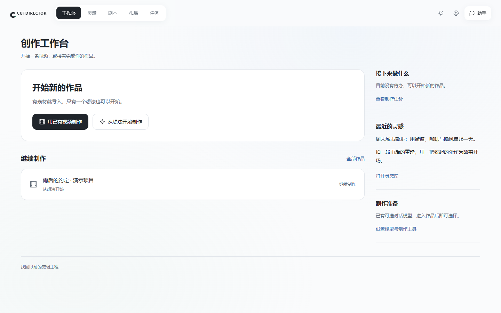
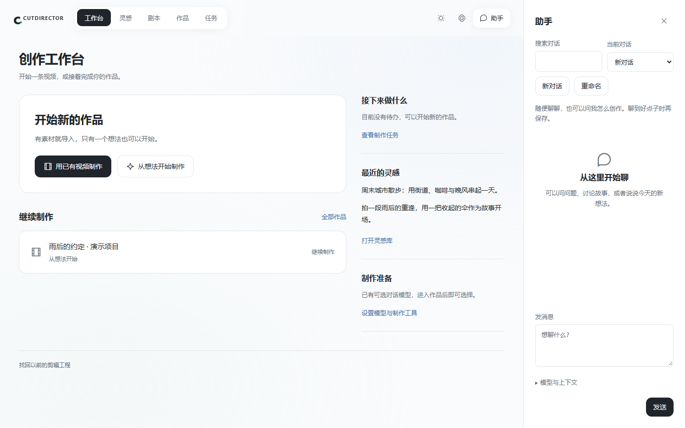
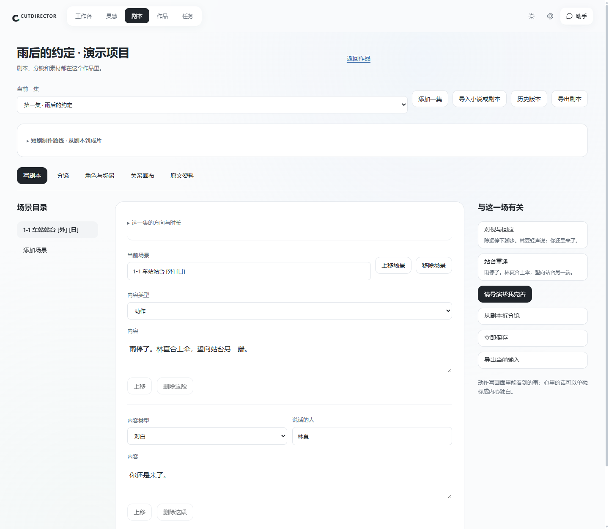
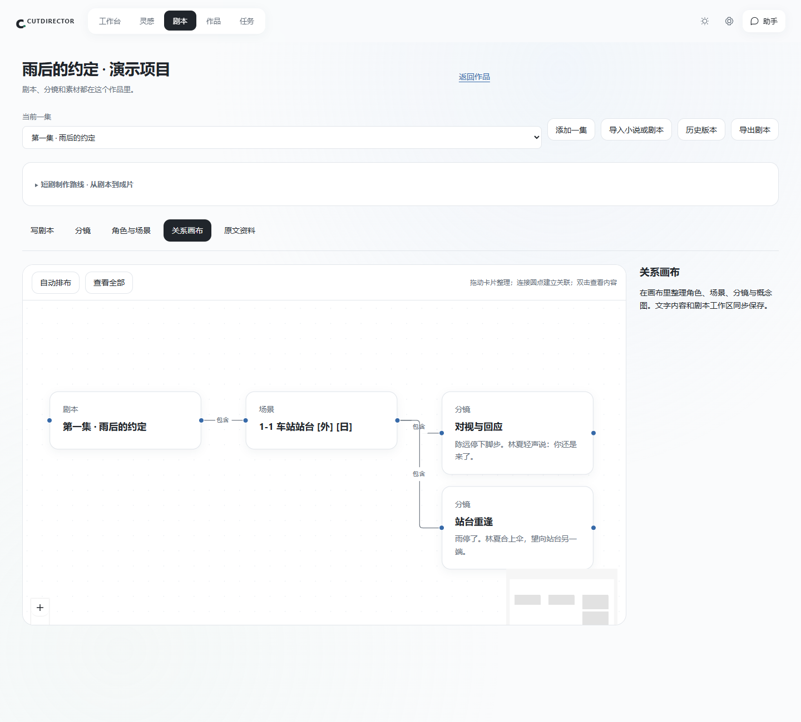
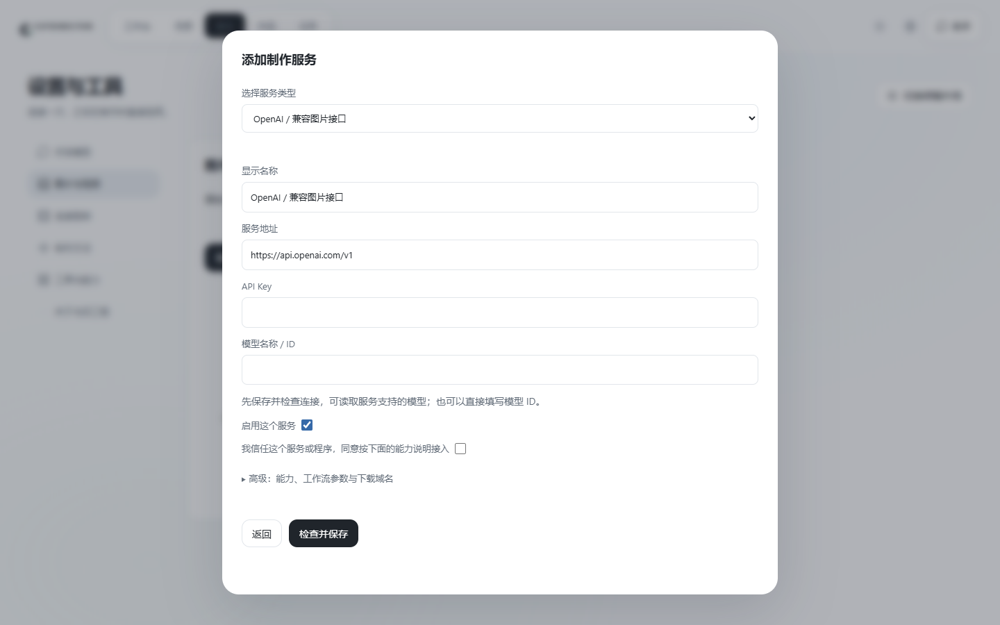

# CUTDIRECTOR

**把想法、剧本、AI 制作和剪映精修，放进同一个创作工作台。**

CUTDIRECTOR 是基于 DSH 插件基座的视频创作集成工作台。你可以先随手记下一个想法，和助手聊清楚，再把它整理成剧本与分镜，连接需要的图片、视频或工作流服务，选用满意的素材，最后交给剪映继续精修。

当前公开快照为 **0.3.0-preview.7**，仅保留 **DSH 内嵌工作台**。本仓库提供源码和开发文档，目前没有面向所有电脑的一键安装成品。

[查看全部界面截图](docs/product/SCREENSHOTS.md) · [了解产品与使用流程](docs/product/PRODUCT-GUIDE.md) · [V3 PRD](docs/product/CUTDIRECTOR-V3-PRD.md) · [技术执行手册](docs/product/CUTDIRECTOR-V3-技术执行手册.md)

> 截图拍摄于 2026-11-10，来自当前源码运行的 DSH 同源认证预览，使用独立演示数据。未展示个人账号、密钥或真实工程；截图没有调用付费模型，也不作为生成效果实测证明。

## 适合谁

- 不太会剪辑，希望有人把下一步讲明白的创作者。
- 已有素材，想减少整理、规划和反复切换工具的轻度剪辑用户。
- 想从故事或小说开始，按集管理剧本、角色、场景和分镜的短剧创作者。
- 已有图片、视频 API 或 RunningHub / ComfyUI 工作流，希望把它们接到同一入口的用户。

目前以**单集或单次交付 25 分钟以内**为产品边界。接近该上限的真实长片验收仍待完成。

## 可以在这里做什么

| 模块 | 用户可以做什么 |
| --- | --- |
| 工作台 | 从已有视频或一个想法开始，继续最近作品，查看接下来要做的事 |
| 灵感 | 保存文字和来源链接，搜索、整理记录，再选择是否发展成作品 |
| 助手 | 自由聊天、问使用方法、讨论创意；查看历史、搜索、新开对话 |
| 剧本 | 按作品、分集和场景写作，导入小说或剧本，保存历史版本 |
| 分镜与概念资料 | 拆分镜头、调整顺序、关联原文，整理角色、场景、道具和概念图 |
| 关系画布 | 拖动和连接剧本、场景、分镜等内容，查看它们的关系 |
| 制作素材 | 选择已配置服务、制作要求和参考素材，确认后提交，保留候选结果 |
| 画面与声音 | 安排主画面、叠加画面、对白、音效和配乐，再交给剪映 |
| 工具与制作方法 | 接入 HTTP / MCP / DSH 工具，导入导出工具配置与 Skill |
| 任务与记录 | 查看进度、失败和待确认任务，核对结果后再决定是否重试 |

### 日常聊天与专业任务分别处理

日常聊天直接使用你在 DSH 选择的模型，不要求回答 JSON，也不强制把问题变成灵感。问工作台怎么用、讨论一般知识或聊一个创意，都可以直接进行。

当你从剧本或分镜工作区发起专业任务时，导演才会加载对应资料和制作规则，给出可以检查、选择采用的建议。**聊天回复不会直接修改工程；需要生成、上传或交付时，仍会进入对应的确认步骤。**

### 剧本、分镜和角色资料放在同一个作品里

剧本支持动作、对白、旁白、内心独白和音效的区分。分镜可以关联剧本来源，也可以复制、拆分、合并和排序。修改剧本后，旧建议需要重新核对，避免覆盖新的内容。

关系画布与剧本、分镜共享内容；画布里的连线用于整理关联，不会自动开始生成。灵感库仍保持整齐卡片，不使用无限画布。

### 按需要接入服务

对话模型复用 DSH 已配置的厂商。图片和视频制作服务在工作台设置中单独添加：

- OpenAI 兼容图片接口、方舟图片与视频。
- 用户自己账号下的 RunningHub 工作流、本机已运行的 ComfyUI。
- 自定义 HTTP、MCP HTTP、可信本地 MCP 程序及 DSH 工具。
- 可导入导出的制作方法（Skill），按任务阶段和执行器匹配使用。

支持某种接入方式，不等于已经拥有对应账号、模型、工作流或调用额度。ComfyUI 节点和工作流依赖需要用户准备。Codex 原生图片执行器仍受本机隔离检查限制，当前不能视为可用。

## 一条视频怎么完成

1. **记下想法，或导入已有素材。** 不确定怎么开始，可以先问助手。
2. **把内容说清楚。** 确定要讲什么、给谁看、希望多长；短剧可以先写或导入剧本。
3. **整理分镜与资料。** 保存镜头、角色、场景与参考，必要时请导演提出建议。
4. **准备并确认制作。** 选择服务、目标和参考素材，核对上传及可能的费用；结果先进入候选。
5. **选用结果并交付。** 检查素材，安排画面与声音，创建剪映草稿继续精修。

第一次使用建议先完成 **10 秒小样**。把一小段流程跑通，再扩展到完整一集。更详细的操作和示例见 [产品与使用指南](docs/product/PRODUCT-GUIDE.md)。

## 安装与开发

**已经安装插件的用户**：从 DSH 侧栏进入 CUTDIRECTOR。在 DSH 配置对话模型；需要生成媒体时，再到工作台添加对应服务。

**首次从源码安装的开发者**：需要 DSH，以及 Node.js 24+。剪映草稿交付还需要可用的 Python、FFprobe 和相应剪映环境。当前源码中保留了一些开发机示例路径，使用前需改为自己的路径。

~~~powershell
npm ci
npm run build:studio
~~~

| 用途 | 入口 |
| --- | --- |
| 构建本地关系画布 | tools/build-studio.cjs |
| 打包 DSH 插件 | tools/package-v3.cjs |
| 创建个人预览包 | tools/create-v3-preview.cjs |
| 规划、备份并安装插件 | tools/install-v3.cjs |
| 数据备份与恢复到新目录 | tools/v3-data-backup.cjs |
| 校验 DIY 工具清单 | tools/validate-tool.cjs |

打包和安装参数请结合 [技术执行手册](docs/product/CUTDIRECTOR-V3-技术执行手册.md)、[工具接入说明](docs/v3/创作扩展与工具接入-v2.md) 与工具的 CLI 用法。不要直接复制他人的数据路径或覆盖已有 DSH profile。

## 实现边界与当前验证

| 内容 | 当前状态 |
| --- | --- |
| 助手多轮消息格式、闲聊与专业任务分离 | 已修复；完成定向本地验证 |
| 剧本、分镜、画布、服务接入界面 | 已实现；完成演示数据下的浏览器检查 |
| 工具授权、幂等、异步查询与素材回收 | 已实现；完成本机模拟供应商流程检查 |
| 真实厂商生成质量、费用与每种第三方服务连接 | 待真实账号验收，未标记通过 |
| Codex 原生出图、WSL2 执行后端 | 当前环境未通过 / 待验证 |
| 多轨剪映完整导出、接近 25 分钟作品 | 待真实交付验收 |
| 新手群体试用与完整设计门禁 | 尚未全部完成；设计检查有 iframe 外层识别限制 |

这次截图只补充产品展示，没有新增真实模型、图片或视频生成验收。详细记录见 [创作扩展交付](docs/product/CUTDIRECTOR-V3-创作扩展-r3-交付.md) 和 [助手修复交付](docs/product/CUTDIRECTOR-V3-助手对话修复-r4.md)。

## 项目结构与资料

~~~text
src/v3/host/       DSH 宿主、模型调用与接口桥接
src/v3/service/    作品、会话、剧本、任务和工具等本地服务
src/v3/web/        内嵌工作台界面
src/v3/frontend/   本地构建的 React Flow 画布
examples/tool-v2/  工具标准与接入示例
tools/            构建、打包、安装和备份
test/             领域与接口测试
docs/product/     产品文档、使用指南与截图索引
~~~

- [产品与使用指南](docs/product/PRODUCT-GUIDE.md)
- [完整界面图集](docs/product/SCREENSHOTS.md)
- [V3 PRD](docs/product/CUTDIRECTOR-V3-PRD.md)
- [V3 技术执行手册](docs/product/CUTDIRECTOR-V3-技术执行手册.md)
- [工具接入标准 v2](docs/v3/创作扩展与工具接入-v2.md)
- [扩展工具开发](docs/v3/扩展工具开发.md)
- [历史运行说明](README-legacy.md)

## 数据与第三方许可

本仓库不包含用户工程、登录凭据、API Key、依赖目录、浏览器缓存、本机发行包或第三方模型权重。截图使用独立演示数据。

保留现有第三方许可证声明。React、React Flow 等组件保留各自许可；Easy Jianying 的固定版本遵循 PolyForm Noncommercial，H3 和服务商遵守对应上游条款。当前没有为整个项目授予统一开源许可；公开源码不等于获得商业再分发授权。
