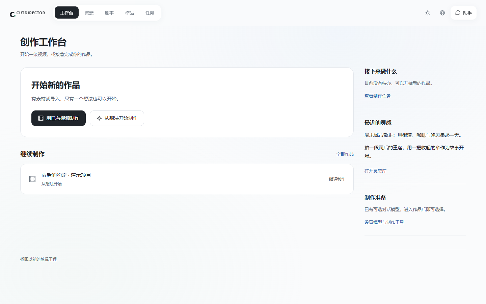
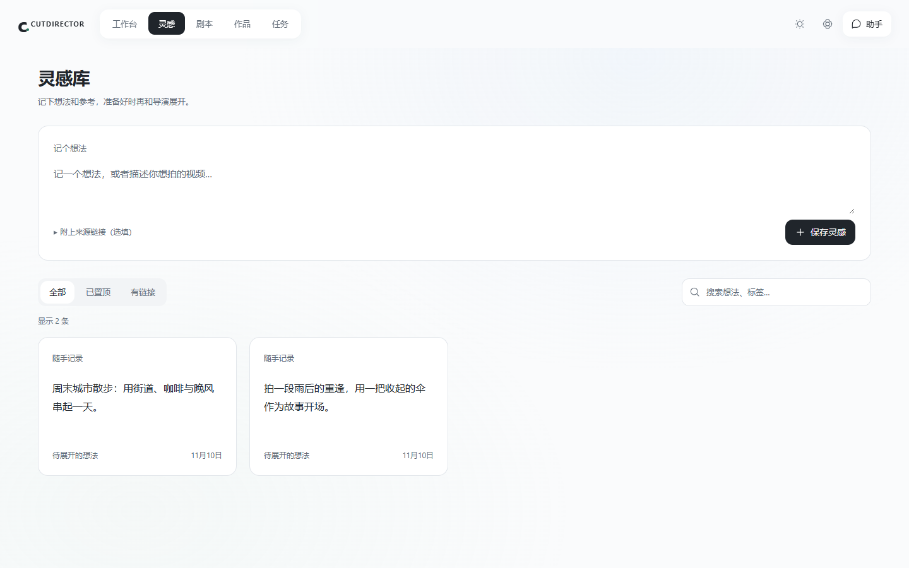
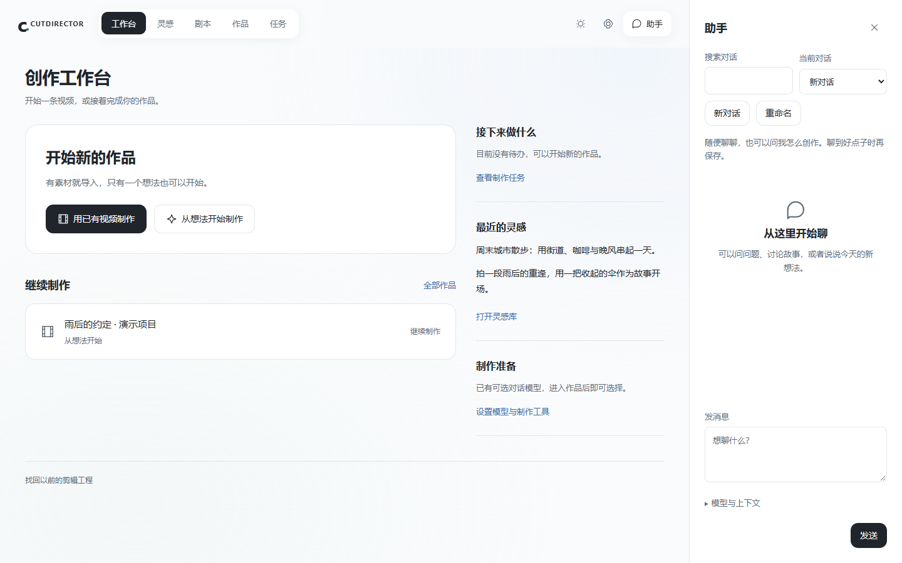
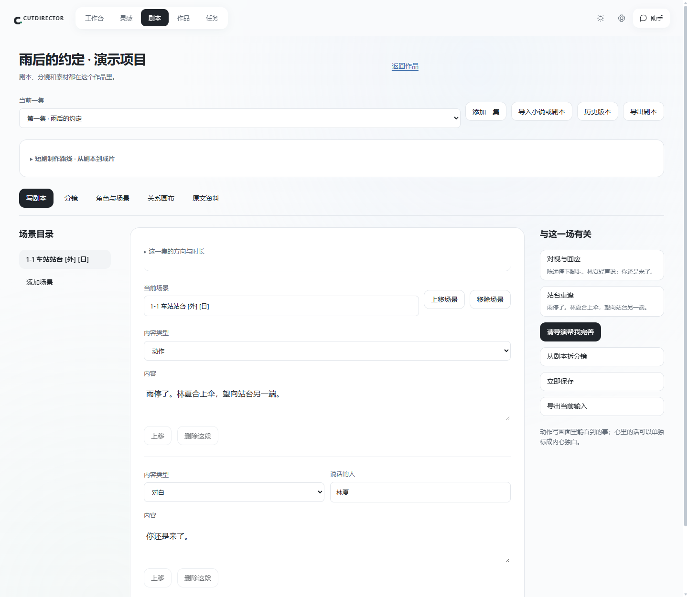
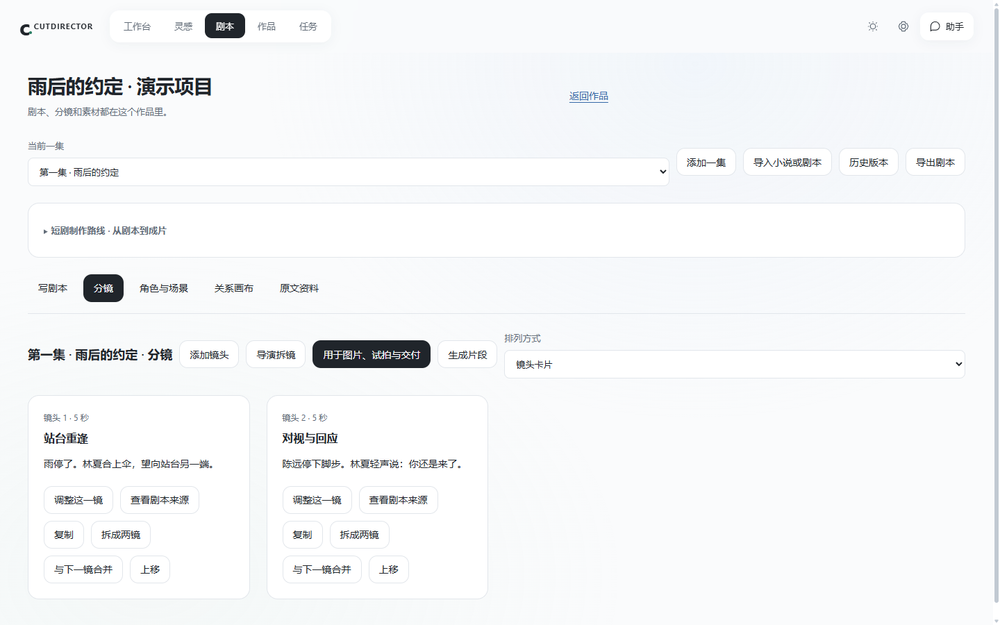
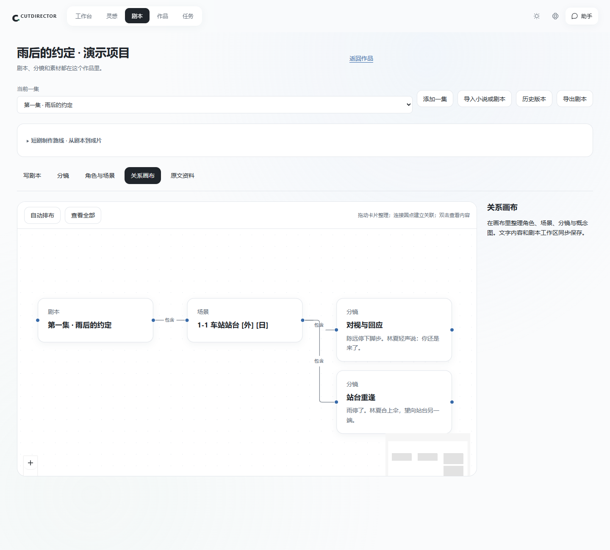
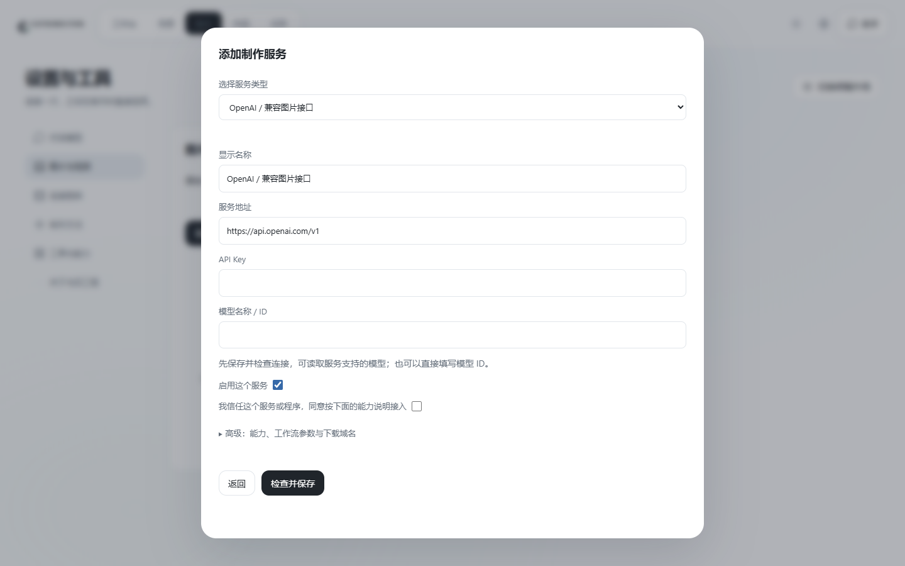
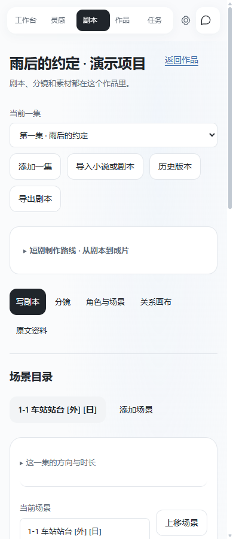

# CUTDIRECTOR 界面图集

版本：0.3.0-preview.7。拍摄日期：2026-11-10。

以下8张图片均为当前源码实际渲染的界面，不是设计稿。拍摄使用独立演示工程，在 DSH Host 的同源认证 iframe 预览中运行；没有展示 DSH 外层账号侧栏。演示模型仅提供目录，没有发送模型请求，也没有调用图片或视频生成服务。

图片中的“雨后的约定”及人物、灵感均是专门准备的虚构内容。没有复用个人工程、聊天、登录信息或密钥。截图记录了拍摄时的视口，后续界面可能调整。机器可读的来源说明见 [provenance.json](../screenshots/provenance.json)。

## 1. 创作工作台

首页把开始制作、继续最近作品、待办和最近灵感放在一起。有素材和只有想法的用户分别选择对应入口。

## 2. 灵感库

用整齐卡片记录想法，附上来源，之后再决定是否发展成作品。灵感库与作品内关系画布各有用途，不把随手记录变成复杂节点图。

## 3. 独立助手

可以在当前工作台打开助手，闲聊、问使用方法或讨论创意；支持历史搜索、新对话和改名。模型与上下文按需展开。此图展示空白新对话，没有把预设台词冒充真实模型回答。

## 4. 剧本工作区

场景目录、正文和相关内容一起展示。用户可以区分动作与台词，添加场景，导入原文，查看版本或请导演给建议。

## 5. 分镜

每镜记录画面和时长。调整、复制、拆分、合并与排序都有明确入口，也可以回看剧本来源。示例两镜为人工准备的演示内容。

## 6. 关系画布

把剧本、场景与分镜的联系放在同一个视图里。支持拖动、缩放和自动排布。连线整理内容关系，不自动运行付费工作流。

## 7. 添加制作服务

普通用户先选择预设，填写地址、Key、模型或工作流，再检查并保存。工具标准和参数映射放在高级区域。截图中 Key 为空，没有真实凭据。

## 8. 窄屏布局

在较窄的内嵌区域中，编辑内容改为纵向排列。此图为390像素宽的浏览器视口，不代表提供了独立移动端 App。

## 看图后怎么开始

- 想了解入口和一条视频的完整流程：[产品与使用指南](PRODUCT-GUIDE.md)。
- 想了解设计目标与完整需求：[V3 PRD](CUTDIRECTOR-V3-PRD.md)。
- 想从源码安装或开发：[技术执行手册](CUTDIRECTOR-V3-技术执行手册.md)。
- 想接自己的工具：[工具接入说明](../v3/创作扩展与工具接入-v2.md)。

[返回仓库首页](../../README.md)
